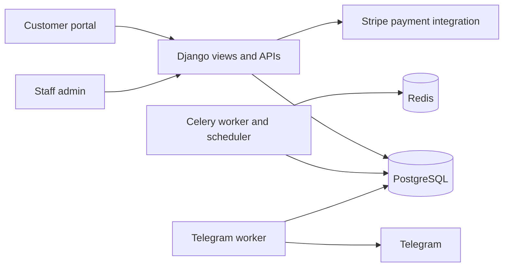

<p align="center">
  
  
</p>

<p align="center">
  <a href="#capabilities">Capabilities</a> ·
  <a href="#architecture">Architecture</a> ·
  <a href="#local-development">Local development</a> ·
  <a href="#source-map">Source map</a>
</p>

A Django booking and operations application for a salon or spa. It connects customer
self-service, staff schedules, client intake and payment records, with a back office
for the people running the service business.

## Capabilities

- **Scheduling:** services, staff and room availability, booking carts, multi-item
  appointments, rescheduling and cancellation workflows.
- **Client care:** customer profiles, intake assignments, documents, reviews and
  email verification.
- **Payments:** Stripe checkout and webhook handling, saved-card flows, staff payment
  records, refunds, no-show handling and receipt generation.
- **Staff operations:** role-oriented dashboards, work days, time off, service
  assignments, product sales and reporting views.
- **Background work:** Celery workers and scheduled tasks for operational workflows.
- **Telegram:** a separate bot worker, subscriptions and operational commands, with
  an optional staff assistant that requires provider configuration.

## Architecture



| Layer | Implementation |
| --- | --- |
| Application | Python 3.12, Django 5.2, Django REST Framework |
| Interface | Django templates, Jazzmin, autocomplete widgets |
| Persistence and tasks | PostgreSQL, Redis, Celery |
| Integrations | Stripe, Telegram, configurable email/SMS and S3 storage |
| Documents | WeasyPrint, xhtml2pdf, receipt templates |

## Local development

Start from a fresh checkout with an empty local PostgreSQL database. Configure
`SECRET_KEY` and `DATABASE_URL` using your own local values. Full setup and optional
provider settings are in [the development guide](docs/DEVELOPMENT.md).

```bash
python3.12 -m venv .venv
source .venv/bin/activate
python -m pip install -r requirements.txt
# Configure the local environment and empty PostgreSQL database first.
python manage.py migrate
python manage.py createsuperuser
python manage.py runserver 127.0.0.1:8000
```

Open [the staff admin](http://127.0.0.1:8000/admin/) or
[customer login](http://127.0.0.1:8000/accounts/login/). Create your own local user;
this documentation provides no shared account credentials.

Payment, SMS, email, AI and Telegram providers are separately configured. Use test
accounts and explicitly selected local recipients. The commands above are source
entry points, not a claim of a newly verified deployment or running provider service.

## Source map

| Area | Code and documentation |
| --- | --- |
| Project settings, routes and Celery | [booking/](booking/) |
| Customer and staff portal | [accounts/](accounts/) |
| Scheduling, models, payments and tasks | [core/](core/) |
| Stripe integration | [core/payments/stripe_api.py](core/payments/stripe_api.py) |
| Telegram worker and assistant | [telegrambot/](telegrambot/) |
| Setup and persistent uploads | [Development](docs/DEVELOPMENT.md) |
| Payments, webhooks and messaging | [Integrations](docs/INTEGRATIONS.md) |

## Scope and licence

Use a dedicated local database and configuration when working with a checkout.
Payment and notification features require configured providers; PDF rendering also
depends on its native system libraries. Do not treat local development defaults as
a production security baseline.

The repository's existing [CC0 1.0 Universal dedication](LICENSE) is preserved.
Bundled third-party assets retain their own licence notices.
